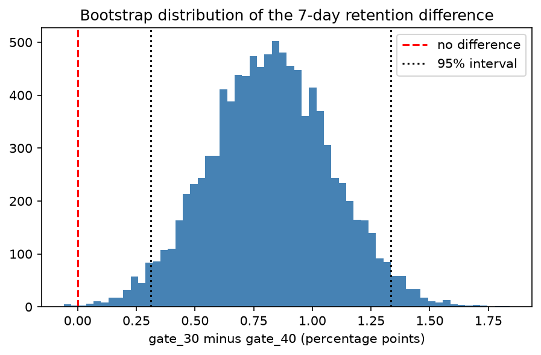
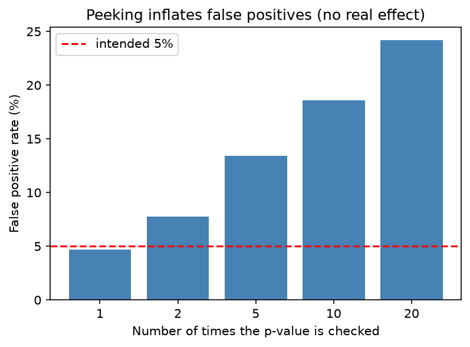
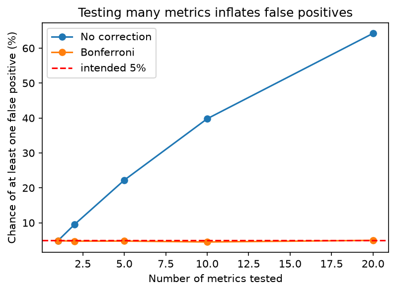

# Cookie Cats A/B Test: does moving the gate from level 30 to 40 hurt retention?

**Notebook:** [ab_test.ipynb](ab_test.ipynb)

**Headline:** moving the first gate to level 40 lowered 7-day retention by 0.82 percentage points (95% CI 0.31 to 1.33, p = 0.0016), so the recommendation is not to ship it unless revenue data shows a gain that outweighs the loss.

## Business problem
A mobile game (Cookie Cats) moved its first gate from level 30 to level 40 for half of new players. Should the product team ship the change?

## Data
About 90k players from the Kaggle "Mobile Games A/B Testing - Cookie Cats" dataset: player ID, version (`gate_30` or `gate_40`), game rounds in the first 14 days, and whether the player returned after 1 and 7 days. The data is not included in this repo.

## Experiment design
- **Primary metric:** 7-day retention. **Secondary:** 1-day retention. **Supporting:** game rounds.
- **H0:** retention is the same in both versions. **H1:** it differs (two-sided).
- Metrics were chosen before looking at the results.

## Data checks
- No missing values and no duplicate user IDs.
- Group sizes are 45,489 (gate_40) and 44,700 (gate_30). The 50/50 split test gives p = 0.0086, which is borderline under the common 0.001 alert threshold, so it is recorded as a limitation.
- One gate_30 player has 49,854 rounds, almost certainly a bot or logging error. Retention is yes/no per player, so it barely affects the main result, but comparisons of rounds use the median.

## Results
| Metric | gate_30 | gate_40 | Difference | p-value |
|---|---|---|---|---|
| 7-day retention (primary) | 19.02% | 18.20% | 0.82 points | 0.0016 |
| 1-day retention | 44.82% | 44.23% | 0.59 points | 0.0744 |
| Median game rounds | 17 | 16 | 1 round | bootstrap interval [0, 1] |

- **Effect size:** the 7-day difference has a 95% confidence interval of 0.31 to 1.33 points, a 4.3% relative drop. That is about 820 fewer active players per 100,000 installs (plausible range 310 to 1,330).
- **Bootstrap:** resampling gives the same interval (0.31 to 1.34), so the result does not depend on a normal approximation.
- **1-day retention** is lower too but not significantly, which does not show the versions are equal.



## Power analysis
About 35,350 players per group were needed to detect the observed gap at 80% power, against about 45,000 in the experiment. The minimum detectable difference was about 0.73 points, so smaller effects, including the 1-day gap, could not be reliably resolved.

## Why not peek? A simulation
In 5,000 simulated experiments with no real effect, checking significance repeatedly and stopping at the first p < 0.05 gave false positives in 4.7% of cases with one look, 13.4% with five looks and 24.2% with twenty looks. Pre-planning the sample size avoids this.



## Multiple testing
Two retention metrics were tested. After Bonferroni, Holm and Benjamini-Hochberg corrections, 7-day retention stays significant (adjusted p = 0.0031) and 1-day retention does not (adjusted p = 0.074 to 0.149). In a simulation with no real effects, testing 20 metrics gave at least one false positive 64.2% of the time uncorrected, against about 5% with Bonferroni.



## Recommendation: do not ship the level-40 gate (keep gate_30)
**Why:** 7-day retention is lower with gate_40, and this holds after multiple-testing correction.

**Caveats**
- The dataset has no revenue data. A later gate could raise in-app purchases or ad views per player, which might outweigh the retention loss. This is the main thing to check.
- The sample-ratio check was borderline, so group assignment should be confirmed with engineering.
- The observed effect is close to the minimum detectable difference, so its exact size is uncertain.
- Retention was measured at day 1 and day 7 only, so longer-term effects are unknown.

**Decision rule:** ship gate_40 only if revenue per player gained from the later gate outweighs the lost players, within the 310 to 1,330 per 100,000 range. Otherwise keep gate_30.

**Next steps:** compare revenue per player between groups, confirm the assignment with engineering, and if the team still wants a later gate, test a smaller move (for example level 35) with a pre-planned sample size.

## Files
| File | What it does |
|---|---|
| `ab_test.ipynb` | Full analysis: checks, tests, intervals, bootstrap, power, simulations, recommendation |
| `charts/` | Chart images used in this README |
| `requirements.txt` | Python packages |

## How to reproduce
1. Download the dataset from Kaggle and place `cookie_cats.csv` in a `data/` folder.
2. Install the packages and open the notebook:

```
pip install -r requirements.txt
```